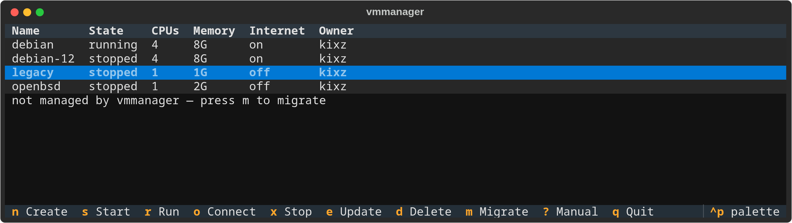

# vmmanager

A terminal UI for OpenBSD's vmm/vmd virtual machines. Think VirtualBox, but in a terminal and built on `vmctl` and `vm.conf`: create, start, run, connect, stop, update, delete and migrate VMs, with networking set up for you.



## Requirements

- OpenBSD (tested on 8.0, amd64) with virtualization enabled in the BIOS
- Python 3.11+
- `vmd` running (`rcctl enable vmd && rcctl start vmd`) and the VM BIOS firmware (`fw_update`); vmmanager offers to do both on first run
- `doas` for creating, changing, deleting and migrating VMs (`permit persist :wheel` in `/etc/doas.conf` saves you a password prompt per step)

## Installation

### Quick install (recommended)

```
$ pkg_add py3-pipx
$ pipx install openbsd-vmmanager
```

Or with pip:

```
$ pip install openbsd-vmmanager
```

Then run:

```
$ vmmanager
```

### From source

```
$ git clone https://github.com/OpenBSDGuy/vmmanager
$ cd vmmanager
$ python3 -m venv venv && . venv/bin/activate
$ pip install -e .
$ vmmanager
```

## First run

vmmanager checks the host before showing your VMs and offers a fix for anything missing: `vmd` not running, missing VM firmware, or a VM whose configuration is broken (for example because its folder was deleted by hand). It also offers to install the man pages system-wide.

The first time you create a VM with Internet on, vmmanager sets up NAT for VMs once: it writes `/etc/vmmanager/pf.conf` (loaded as a pf anchor from a marked block it adds to `/etc/pf.conf`), turns on IP forwarding, and starts `unwind` if no DNS resolver is running. Every change that needs root is explained first and asks before it runs through `doas`.

## Usage

| Key | Action                                                                 |
|-----|------------------------------------------------------------------------|
| n   | Create a VM: name, memory, CPUs, disk size, install ISO, Internet on/off |
| s   | Start the VM in the background                                         |
| r   | Run: start the VM and attach its serial console                        |
| o   | Connect to the console of a running VM                                 |
| x   | Stop the VM (graceful first, then offers a force stop)                 |
| e   | Update memory, CPUs, ISO and Internet of a stopped VM                  |
| d   | Delete a stopped VM; asks separately before removing its disk          |
| m   | Migrate a VM you wrote by hand in `/etc/vm.conf` into vmmanager        |
| ?   | Show the manual page                                                   |
| q   | Quit                                                                   |
| ~.  | Leave a VM console and return to vmmanager                             |

In the ISO browser, `.` shows or hides dot files and folders.

## Notes

- Each VM gets its own folder, `~/vmmanager/<name>/`, holding its disk and a small `vmmanager.toml`. Its `vm.conf` block lives in `/etc/vmmanager/<user>/<name>.conf`, which `/etc/vm.conf` includes through one added line.
- vmmanager never rewrites your hand-written `/etc/vm.conf`. VMs defined there are listed but locked until you migrate them; migration moves the disks, comments out the old block and can be undone by hand (see `vmmanager(8)`, MIGRATING).
- Every VM vmmanager creates is owned by you (`owner` in `vm.conf`), so vmd itself stops other users from starting, stopping or opening the console of your VMs. They can still see them.
- Starting, stopping and the console need no root. Writing configuration does, and every write is checked with `vmd -n` and rolled back if it fails.
- Networking is either on (NAT through the host) or off (no network interface at all, an air-gapped VM).
- Deleting a VM keeps its folder unless you agree to remove it.

## Manual

`vmmanager(8)` covers keys, files, privileges, networking, migration, security and how to uninstall, and `vmmanager.toml(5)` the per-VM file. Read them with `man vmmanager` once installed system-wide (`vmmanager --install-man`), or without installing with `vmmanager --man`.

## License

GPL-3.0
